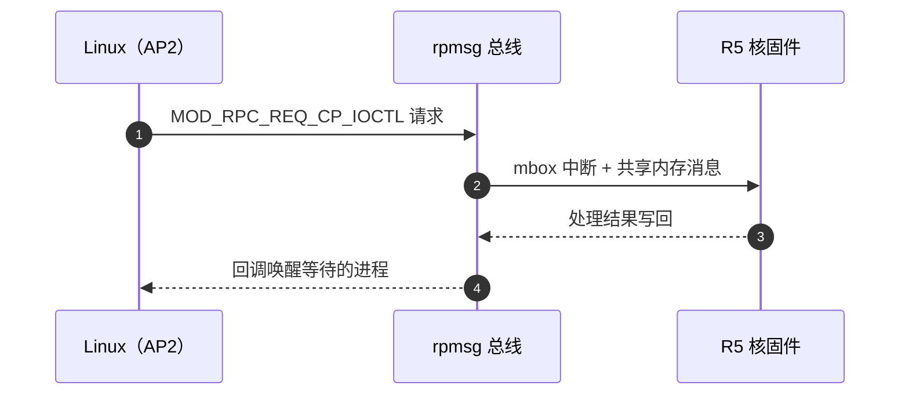
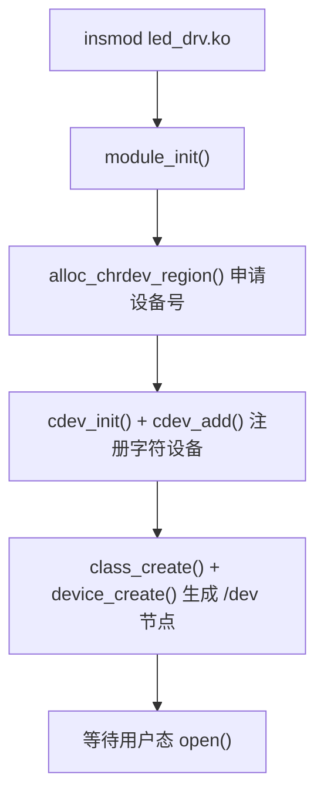
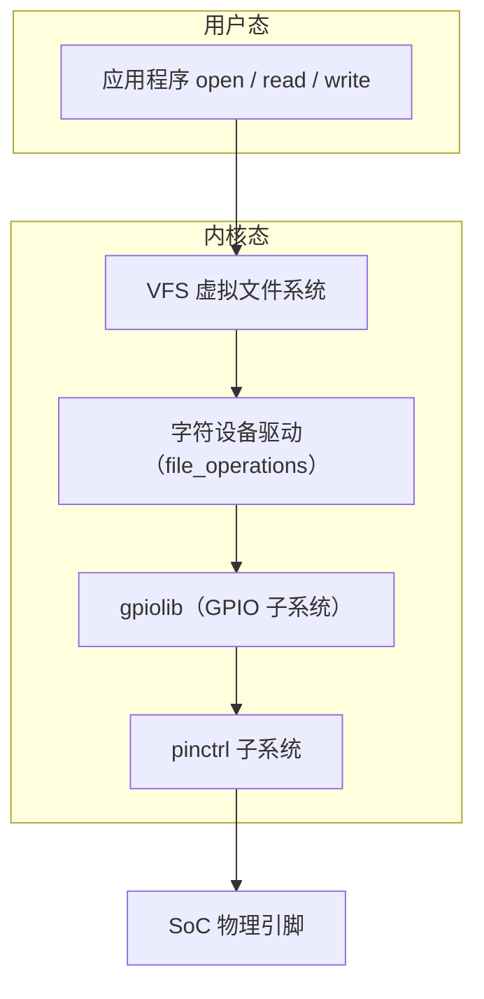
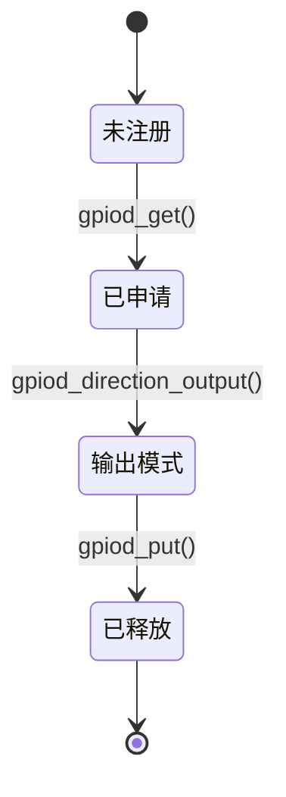
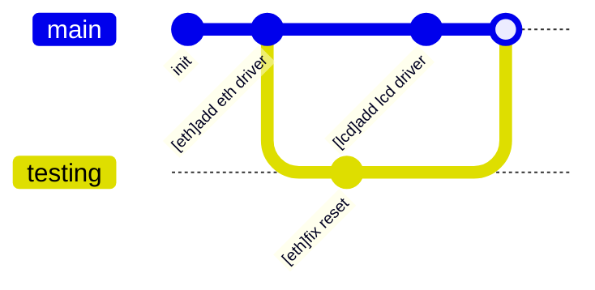
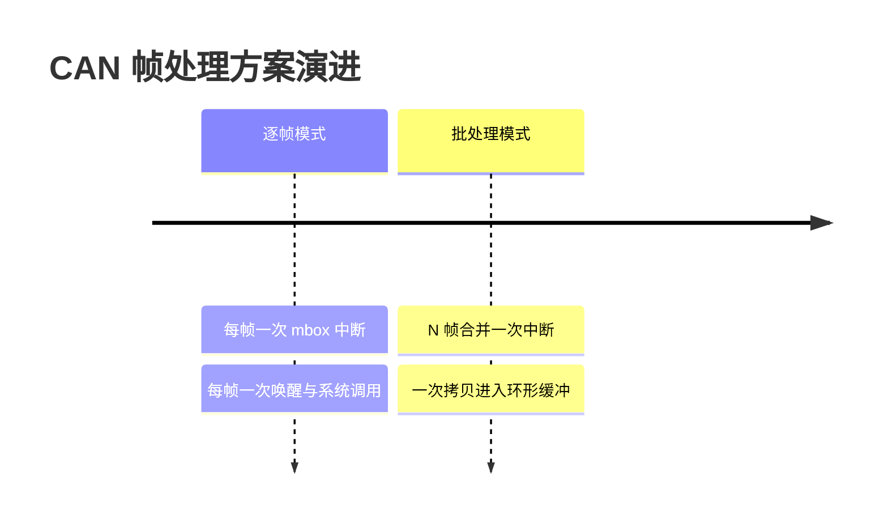
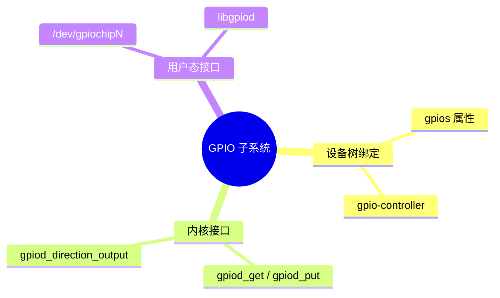
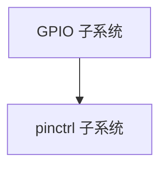

# 图示规范（Mermaid）

Obsidian **原生支持 Mermaid**：用 ```` ```mermaid ```` 代码块书写，阅读视图与实时预览都会渲染。
纯文本、git diff 可读、不依赖图片文件 —— 正好补上「截图难维护、结构靠脑补」的缺口。

图不是笔记的必填装饰。只有当文字难以清楚表达结构、时序、状态或层次时才画；能用一段短文、一棵目录树或一张表说清的，不画图。

---

## 一、选图速查

| 要表达什么 | Mermaid 类型 | 典型场景 |
|---|---|---|
| 流程、决策、调用链 | `flowchart TD/LR` | 驱动 probe 流程、批处理流程、排错决策树 |
| 多方交互、消息时序 | `sequenceDiagram` | Linux↔R5 的 rpmsg 通信、ioctl 调用链、中断握手 |
| 状态变迁 | `stateDiagram-v2` | GPIO 申请/释放、驱动加载状态、任务状态机 |
| 提交历史、分支合并 | `gitGraph` | git 分支策略、rebase vs merge 对比 |
| 模块分层、架构 | `flowchart` + `subgraph` | 内核子系统分层、软硬件边界 |
| 知识结构 | `mindmap` | 主题 MOC 里的知识地图 |
| 演进时间线 | `timeline` | 方案演进（逐帧 → 批处理）、版本变更 |
| 数据结构关系 | `classDiagram` | struct 之间的引用关系 |
| 内存/寄存器布局 | **不用 Mermaid**，用 ASCII 图或表格 | 布局是定宽的，Mermaid 画不好 |

---

## 二、画法铁律

1. **先判断是否需要图。** 只有空间、时序、状态或层级关系仅靠文字会产生歧义时才画；“每个核心机制都配图”不是目标。
2. **一张图只回答一个问题。**「驱动怎么注册」和「中断怎么来」是两件事，画两张。
3. **图是辅助不是替代**：图前后必须有文字解说，把图删了段落依然读得通。
4. **图紧跟它解释的那段话**，不集中在文末堆叠；教程先让读者得到可见结果，再在需要迁移时解释机制图。
5. 一屏放得下：flowchart 节点 ≤ 12 个，sequenceDiagram 参与者 ≤ 5 个。画不下就拆。
6. 节点文字用 `中文短语（英文术语）`，如 `["字符设备驱动（file_operations）"]`。
7. 宽图用横向：`flowchart LR`（分层架构、左右对比）；高图用纵向：`flowchart TD`（流程）。
8. 截图类内容（命令输出、GUI、示波器波形）仍走 `.assets/` 图片，Mermaid 不掺和。
9. **代码流程讲解图先行**：讲调用链 / 核间交互时，时序图或流程图放在相关代码之前，正文按图的步骤编号逐步展开代码，
   写作约定见 `note-style.md`「六、代码、命令与输出」。

---

## 三、按主题备好的骨架

### 3.1 双核/组件交互时序（sequenceDiagram）

Linux 与 R5 的 rpmsg 通信、ioctl 调用链这类「谁先发、谁应答」的内容：



要点：`autonumber` 自动编号方便正文引用「第 3 步」；长中文名用 `participant 别名 as 显示名`；
请求用 `->>`、应答用 `-->>`（虚线），一眼分清方向。

代码讲解场景的标准用法：正文按 `autonumber` 的编号逐步展开，每一步给出
`来源：<项目根相对路径>` 的标注和保留完整签名（返回类型+函数名+形参+`{}`）的代码摘录，
再加文字解说 —— 读者对照图编号读代码，不会迷失在函数跳转里
（完整约定见 `note-style.md`「六、代码、命令与输出」）。

### 3.2 流程图（flowchart）

驱动注册、初始化、排错决策：



### 3.3 分层架构（flowchart + subgraph）

软硬件边界、子系统关系：



### 3.4 状态机（stateDiagram-v2）

资源申请/释放、生命周期：



### 3.5 分支历史（gitGraph）

替代 git 笔记里的静态截图，提交历史/合并策略直接可画：



### 3.6 演进对比（timeline）

方案演进类内容（如逐帧 → 批处理的动机）：



### 3.7 知识地图（mindmap）

放在主题 MOC 里做导读：



---

## 四、让图中节点可点击（官方支持，可选增强）

Obsidian 原生支持把 Mermaid 节点变成内部链接：在图表代码末尾加一行 `class`，把要跳转的节点声明为 `internal-link`。
节点文本需要与目标笔记名**完全一致**。



- 笔记名含特殊字符时加双引号：`class "⨳ 特殊字符" internal-link`，或写成 `A["⨳ 特殊字符"]`
- 图内的内部链接**不会出现在 Obsidian 关系图谱中**，也不能替代正文链接
- 因此这是**增强而非基础导航**：图旁或图后的正文仍必须给标准 `[[wikilink]]`，
  图谱节点只省一次点击，不承担唯一入口
- 节点名对不上笔记名时不会报错、只是点不动 —— 写完在 Obsidian 里实际点一下验证
- 两种图（`flowchart` / `graph`）都支持；仍不满足时退回纯文字 + `[[wikilink]]`

## 五、语法避坑

| 坑 | 处理 |
|---|---|
| 节点文字含括号、冒号、分号、引号 | **整段用双引号包起来**：`A["gpiod_direction_output()"]` |
| 中文显示问题 | 无问题，但同样建议加双引号 |
| `sequenceDiagram` 里长中文名 | 用 `participant AP as Linux（AP2）` 起别名，后文用别名 |
| 箭头文字含括号 | `A -->|"设置方向（output）"| B`，文字也加引号 |
| 渲染失败 | 先在 Obsidian 里打开笔记目测；仍失败就降级为 flowchart 重画，别死磕 |
| mindmap / timeline / block-beta 等较新类型 | 老版本 Obsidian 可能不认，渲染失败时降级 |

**写完必须验证**：`python scripts/ob.py open --vault "<库名>" --path "<笔记>"` 在 Obsidian 里
打开看一眼渲染结果。渲染不出来比不画更糟。

---

## 六、和其他素材的分工

| 素材 | 承担 |
|---|---|
| Mermaid | 结构、流程、时序、状态、分层 —— 逻辑关系 |
| `.assets/` 图片 | 截图、波形、原理图 —— 无法重绘的原始证据 |
| ASCII 图 | 内存布局、寄存器位段 —— 定宽对齐才看得懂的内容 |
| 表格 | 选项速查、对比 —— 碎片信息的收纳 |
