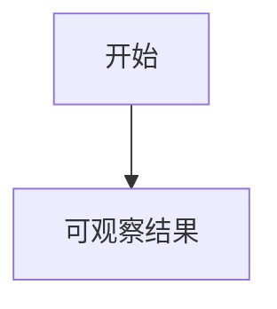

# Obsidian 语法最小基线

只记录本 skill 写笔记时最容易写错、又会影响渲染和链接维护的 Obsidian 扩展语法。标准 Markdown 不在这里重复。

## 一、内部链接

```markdown
[[笔记名]]
[[笔记名|显示文字]]
[[笔记名#章节标题]]
[[#当前笔记中的章节]]
```

- 库内笔记一律优先用 wikilink；外部网页才用 `[文字](https://example.com)`
- 目标存在同名笔记时优先写仓库相对路径，如 `[[Linux内核/GPIO 子系统]]`
- 链接到某篇笔记的具体机制时优先链接到章节，不要只丢整篇笔记
- 同一段中首次出现的独立概念加链接即可，不反复制造蓝色文字

## 二、嵌入

```markdown
![[笔记名]]
![[笔记名#章节标题]]
![[图片.png|640]]
![[文档.pdf#page=3]]
```

- 嵌入用于复用稳定内容、图片或原始证据；不要用嵌入替代一段本应写清楚的解释
- 附件应放进 `<笔记名>.assets/`，正文只嵌入实际需要阅读的文件

## 三、Callout

```markdown
> [!abstract] 完成后你将得到什么
> 一句话说明可观察产物

> [!note] 背景补充
> 主线暂不展开的必要背景

> [!tip] 经验
> 已验证的实践技巧

> [!warning] 风险
> 已知的危险操作或版本陷阱

> [!warning] 待核实
> 当前无法确认的推断，并说明核对目标

> [!question] 待办
> 尚未解决、需要进入后续任务的问题
```

- Callout 标题用来说明语义，不要只写“注意”
- 折叠写法：`> [!note]- 默认折叠`；只对补充材料使用，不要折叠教程主步骤
- 需要列出多行内容时，每行都保留 `>` 前缀

## 四、Frontmatter

```yaml
---
note_type: tutorial
status: draft
tags:
  - Linux/驱动
aliases:
  - GPIO
keywords:
  - gpiod
updated: 2026-09-17
moc: "[[Linux内核 MOC]]"
related:
  - "[[字符设备驱动框架]]"
---
```

- `note_type` 只能是 `tutorial`、`how-to`、`explanation`、`reference`
- `status` 只能是 `draft`、`reviewed`、`needs-verify`、`archived`
- 值中包含 `:`, `#`, `[`, `]`, `{`, `}`, `,` 或前导特殊字符时使用双引号
- `moc` 与 `related` 使用可解析的 wikilink；值不确定时留空，不伪造链接
- 更新元数据优先用 `scripts/note.py frontmatter --dry-run`，再正式写入

## 五、Mermaid

````markdown

````

- 节点文本带括号、冒号、中文长句时整体放进双引号
- 时序图使用 `autonumber` 以便正文按步骤解释
- Mermaid 仅用于结构、流程、时序、状态和层级；图前后仍要有可独立阅读的文字
- 写完用 Obsidian 打开实际笔记确认渲染；旧版 Obsidian 不支持的图类型要降级为 `flowchart`
- 详细的选图和规模限制见 `references/diagrams.md`

## 六、最小语法验收

落盘后执行：

1. 用 `scripts/vault.py links` 或官方 CLI 检查新增 wikilink 是否断链
2. 在 Obsidian 阅读视图查看 Callout、表格、Mermaid 与嵌入是否正常渲染
3. 检查 H1 是否唯一，Frontmatter 是否位于文件首行
4. 若仅为验证语法而发现内容无需改动，不要再次写入文件
